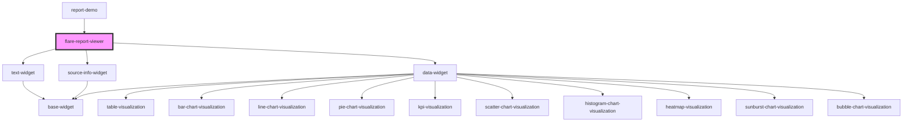

# flare-report-viewer

<!-- Auto Generated Below -->

## Properties

| Property          | Attribute          | Description | Type       | Default     |
| ----------------- | ------------------ | ----------- | ---------- | ----------- |
| `configuration`   | `configuration`    |             | `any`      | `undefined` |
| `fetchChartData`  | `fetch-chart-data` |             | `Function` | `undefined` |
| `isFullscreen`    | `is-fullscreen`    |             | `boolean`  | `false`     |
| `isViewer`        | `is-viewer`        |             | `boolean`  | `false`     |
| `reportId`        | `report-id`        |             | `string`   | `undefined` |
| `showPlaceholder` | `show-placeholder` |             | `boolean`  | `true`      |

## Dependencies

### Used by

 - [report-demo](../report-demo)

### Depends on

- [text-widget](../widgets)
- [source-info-widget](../widgets)
- [data-widget](../widgets)

### Graph

----------------------------------------------

*Built with [StencilJS](https://stenciljs.com/)*
