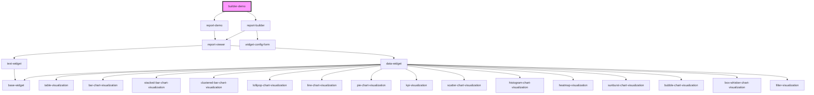

# builder-demo

<!-- Auto Generated Below -->

## Overview

Demo page for `<report-builder>`: the sample report from the viewer demo, an app-built toolbar around the builder's
methods, a `configureWidget` hook with a small dialog of its own, and a live view of what the builder emits.

## Dependencies

### Depends on

- [report-demo](../report-demo)
- [report-builder](../report-builder)

### Graph

----------------------------------------------

*Built with [StencilJS](https://stenciljs.com/)*
