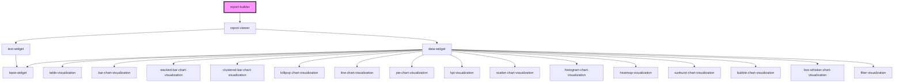

# report-builder

<!-- Auto Generated Below -->

## Overview

Edit layer for a report: select, move, resize, add and delete widgets on the grid. The configuration is
controlled: it is passed in, and every user change is emitted as `configurationChange` with the full next
configuration for the app to apply (and save). Widgets render with the regular `<report-viewer>`, so what you
edit is what the viewer shows. The builder has no toolbar or palette: apps build their own around `addWidget`,
`removeWidgets`, `updateWidget` and `select`.

## Properties

| Property             | Attribute             | Description                                                                                                                                                                                            | Type                          | Default      |
| -------------------- | --------------------- | ------------------------------------------------------------------------------------------------------------------------------------------------------------------------------------------------------ | ----------------------------- | ------------ |
| `columns`            | `columns`             | Presentation, passed to the viewer (see `<report-viewer>`).                                                                                                                                            | `number`                      | `undefined`  |
| `compact`            | `compact`             | `vertical` (default): colliding widgets are pushed down and gaps close upwards. `none`: widgets stay where they are put and moves that would overlap are rejected.                                     | `"none" \| "vertical"`        | `'vertical'` |
| `configuration`      | `configuration`       | The report configuration. Controlled: apply `configurationChange` by setting this again.                                                                                                               | `any`                         | `undefined`  |
| `fetchChartData`     | --                    | Same data function the viewer takes, so widgets show real data while editing.                                                                                                                          | `Function`                    | `undefined`  |
| `gap`                | `gap`                 |                                                                                                                                                                                                        | `number`                      | `undefined`  |
| `interactionPreview` | `interaction-preview` | What a widget shows while it is dragged or resized: `outline` (default) hides its content and keeps the frame and title, which is cheaper and a clearer drop target; `live` keeps the content visible. | `"live" \| "outline"`         | `'outline'`  |
| `readOnly`           | `read-only`           | Turns the editing layer off: the report just renders.                                                                                                                                                  | `boolean`                     | `false`      |
| `reportId`           | `report-id`           |                                                                                                                                                                                                        | `string`                      | `undefined`  |
| `rowAspectRatio`     | `row-aspect-ratio`    |                                                                                                                                                                                                        | `number`                      | `undefined`  |
| `rowHeight`          | `row-height`          |                                                                                                                                                                                                        | `number`                      | `undefined`  |
| `sources`            | --                    | Sources available in the report (overrides `configuration.sources`).                                                                                                                                   | `DataSource[]`                | `undefined`  |
| `theme`              | `theme`               |                                                                                                                                                                                                        | `"auto" \| "dark" \| "light"` | `'auto'`     |
| `widgetCatalog`      | --                    | Describes the widget types users can add: sizes, limits, default config. Types not listed use built-in defaults.                                                                                       | `WidgetTypeDefinition[]`      | `undefined`  |

## Events

| Event                 | Description                                                                                  | Type                              |
| --------------------- | -------------------------------------------------------------------------------------------- | --------------------------------- |
| `configurationChange` | The full next configuration, whenever the user changes the layout or the app calls a method. | `CustomEvent<any>`                |
| `widgetSelect`        | The selection changed.                                                                       | `CustomEvent<{ ids: string[]; }>` |

## Methods

### `addWidget(type: string, options?: { id?: string; title?: string; x?: number; y?: number; w?: number; h?: number; config?: Record<string, any>; }) => Promise<string | null>`

Adds a widget of the given type (at the first free spot, or at `x`/`y`) and selects it. Resolves with its id, or
null when it couldn't be placed (for example `compact: 'none'` and no room at the requested position).

#### Parameters

| Name      | Type                                                                                                             | Description |
| --------- | ---------------------------------------------------------------------------------------------------------------- | ----------- |
| `type`    | `string`                                                                                                         |             |
| `options` | `{ id?: string; title?: string; x?: number; y?: number; w?: number; h?: number; config?: Record<string, any>; }` |             |

#### Returns

Type: `Promise<string>`

### `getSelection() => Promise<string[]>`

The ids of the selected widgets.

#### Returns

Type: `Promise<string[]>`

### `removeWidgets(ids: string[]) => Promise<void>`

Removes widgets and closes the gaps they leave (unless `compact` is `none`).

#### Parameters

| Name  | Type       | Description |
| ----- | ---------- | ----------- |
| `ids` | `string[]` |             |

#### Returns

Type: `Promise<void>`

### `select(ids: string[]) => Promise<void>`

Selects widgets by id (an empty list clears the selection).

#### Parameters

| Name  | Type       | Description |
| ----- | ---------- | ----------- |
| `ids` | `string[]` |             |

#### Returns

Type: `Promise<void>`

### `updateWidget(id: string, patch: Record<string, any>) => Promise<void>`

Merges a patch into a widget (title, config, position, anything). This is how an app applies its own
configuration UI. A position change is run through the layout engine so other widgets make room.

#### Parameters

| Name    | Type                    | Description |
| ------- | ----------------------- | ----------- |
| `id`    | `string`                |             |
| `patch` | `{ [x: string]: any; }` |             |

#### Returns

Type: `Promise<void>`

## Shadow Parts

| Part        | Description |
| ----------- | ----------- |
| `"handle"`  |             |
| `"overlay"` |             |

## Dependencies

### Depends on

- [report-viewer](../report-viewer)

### Graph

----------------------------------------------

*Built with [StencilJS](https://stenciljs.com/)*
