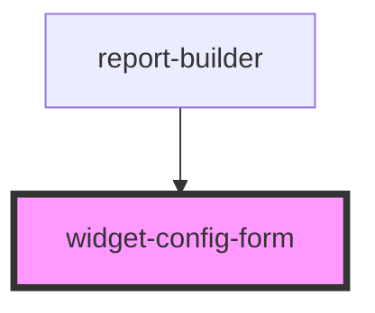

# report-builder

<!-- Auto Generated Below -->

## Overview

The report builder's default configuration form for one widget: a title, and the fields of the widget type's config
schema (see `utils/config-form`). Used by `<report-builder>` when the app gives no `configureWidget` hook (or the hook
returns `undefined`), and usable on its own: it emits `configApply` with the edited widget or `configCancel`.

## Properties

| Property              | Attribute    | Description                                                    | Type                                                                                                                                                                                                                                 | Default     |
| --------------------- | ------------ | -------------------------------------------------------------- | ------------------------------------------------------------------------------------------------------------------------------------------------------------------------------------------------------------------------------------ | ----------- |
| `labels`              | --           |                                                                | `{ title?: string; source?: string; none?: string; apply?: string; add?: string; cancel?: string; moreOptions?: string; rawConfig?: string; invalidJson?: string; noSources?: string; addTitle?: string; configureTitle?: string; }` | `undefined` |
| `mode`                | `mode`       |                                                                | `"add" \| "edit"`                                                                                                                                                                                                                    | `'edit'`    |
| `schema`              | --           | The widget type's config schema.                               | `{ [x: string]: any; }`                                                                                                                                                                                                              | `undefined` |
| `sources`             | --           |                                                                | `DataSource[]`                                                                                                                                                                                                                       | `[]`        |
| `typeLabel`           | `type-label` | Name of the widget type, for the heading.                      | `string`                                                                                                                                                                                                                             | `''`        |
| `widget` _(required)_ | --           | The widget being edited (a new one with defaults when adding). | `{ [x: string]: any; }`                                                                                                                                                                                                              | `undefined` |

## Events

| Event          | Description | Type                                 |
| -------------- | ----------- | ------------------------------------ |
| `configApply`  |             | `CustomEvent<{ [x: string]: any; }>` |
| `configCancel` |             | `CustomEvent<void>`                  |

## Dependencies

### Used by

 - [report-builder](.)

### Graph

----------------------------------------------

*Built with [StencilJS](https://stenciljs.com/)*
