# report-demo

<!-- Auto Generated Below -->

## Dependencies

### Depends on

- [flare-report-viewer](../flare-report-viewer)

### Graph

```mermaid
graph TD;
  report-demo --> flare-report-viewer
  flare-report-viewer --> text-widget
  flare-report-viewer --> source-info-widget
  flare-report-viewer --> descriptive-analysis-widget
  flare-report-viewer --> correlation-analysis-widget
  flare-report-viewer --> one-sample-hypothesis-test-widget
  flare-report-viewer --> independent-two-sample-hypothesis-test-widget
  flare-report-viewer --> paired-two-sample-hypothesis-test-widget
  flare-report-viewer --> welch-two-sample-hypothesis-test-widget
  flare-report-viewer --> data-widget
  text-widget --> base-widget
  source-info-widget --> base-widget
  descriptive-analysis-widget --> base-widget
  descriptive-analysis-widget --> data-widget
  data-widget --> table-visualization
  data-widget --> bar-chart-visualization
  data-widget --> stacked-bar-chart-visualization
  data-widget --> clustered-bar-chart-visualization
  data-widget --> lollipop-chart-visualization
  data-widget --> line-chart-visualization
  data-widget --> pie-chart-visualization
  data-widget --> kpi-visualization
  data-widget --> scatter-chart-visualization
  data-widget --> histogram-chart-visualization
  data-widget --> heatmap-visualization
  data-widget --> sunburst-chart-visualization
  data-widget --> bubble-chart-visualization
  data-widget --> box-whisker-chart-visualization
  data-widget --> base-widget
  correlation-analysis-widget --> base-widget
  one-sample-hypothesis-test-widget --> base-widget
  independent-two-sample-hypothesis-test-widget --> base-widget
  paired-two-sample-hypothesis-test-widget --> base-widget
  welch-two-sample-hypothesis-test-widget --> base-widget
  style report-demo fill:#f9f,stroke:#333,stroke-width:4px
```

----------------------------------------------

*Built with [StencilJS](https://stenciljs.com/)*
