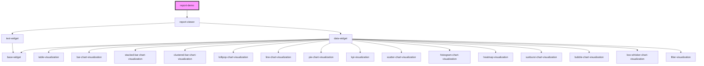

# report-demo

<!-- Auto Generated Below -->

## Dependencies

### Depends on

- [report-viewer](../report-viewer)

### Graph

----------------------------------------------

*Built with [StencilJS](https://stenciljs.com/)*
