# report-viewer

A component for rendering reports with configurable widgets and layouts.

## Configuration

The component accepts a `configuration` object that can include:

- `colorTheme`: The color theme for the report. Valid values: `"blue"`, `"brand"`, `"grayscale"`, `"rainbow"`, `"rainbow-alt"`. Defaults to `"brand"`.
- `sources`: Array of data sources for the widgets
- `widgets`: Array of widget definitions (legacy format)
- `layouts`: Object containing layout definitions for different screen sizes (lg, md, sm, xs)
- `widgets`: Array of widget definitions (new format, used with layouts)

## Height Modes

The component supports two height modes:

- `heightMode="auto"` (default): The report grows vertically to accommodate all content. Suitable for web pages where scrolling is acceptable.
- `heightMode="fixed"`: The report scales to fit within the available height. Suitable for presentations, embedded views, or when you need the entire report to fit in a specific container.

Example configuration:
```json
{
  "colorTheme": "brand",
  "sources": [...],
  "layouts": {
    "lg": [...]
  },
  "widgets": [...]
}
```

<!-- Auto Generated Below -->


## Properties

| Property          | Attribute          | Description | Type                | Default     |
| ----------------- | ------------------ | ----------- | ------------------- | ----------- |
| `configuration`   | `configuration`    |             | `any`               | `undefined` |
| `fetchChartData`  | --                 |             | `Function`          | `undefined` |
| `heightMode`      | `height-mode`      |             | `"auto" \| "fixed"` | `'auto'`    |
| `isFullscreen`    | `is-fullscreen`    |             | `boolean`           | `false`     |
| `isViewer`        | `is-viewer`        |             | `boolean`           | `false`     |
| `reportId`        | `report-id`        |             | `string`            | `undefined` |
| `showPlaceholder` | `show-placeholder` |             | `boolean`           | `true`      |


## Dependencies

### Used by

 - [report-demo](../report-demo)

### Depends on

- [text-widget](../widgets)
- [source-info-widget](../widgets)
- [descriptive-analysis-widget](../widgets)
- [correlation-analysis-widget](../widgets)
- [one-sample-hypothesis-test-widget](../widgets)
- [one-sample-wilcoxon-signed-rank-widget](../widgets)
- [paired-two-sample-wilcoxon-signed-rank-widget](../widgets)
- [independent-two-sample-hypothesis-test-widget](../widgets)
- [paired-two-sample-hypothesis-test-widget](../widgets)
- [welch-two-sample-hypothesis-test-widget](../widgets)
- [one-way-anova-widget](../widgets)
- [welch-anova-widget](../widgets)
- [mann-whitney-u-test-widget](../widgets)
- [kruskal-wallis-test-widget](../widgets)
- [shapiro-wilk-test-widget](../widgets)
- [kolmogorov-smirnov-normality-test-widget](../widgets)
- [anderson-darling-normality-test-widget](../widgets)
- [box-whisker-normality-plot-widget](../widgets)
- [data-widget](../widgets)

### Graph

```mermaid
graph TD;
  report-viewer --> text-widget
  report-viewer --> source-info-widget
  report-viewer --> descriptive-analysis-widget
  report-viewer --> correlation-analysis-widget
  report-viewer --> one-sample-hypothesis-test-widget
  report-viewer --> one-sample-wilcoxon-signed-rank-widget
  report-viewer --> paired-two-sample-wilcoxon-signed-rank-widget
  report-viewer --> independent-two-sample-hypothesis-test-widget
  report-viewer --> paired-two-sample-hypothesis-test-widget
  report-viewer --> welch-two-sample-hypothesis-test-widget
  report-viewer --> one-way-anova-widget
  report-viewer --> welch-anova-widget
  report-viewer --> mann-whitney-u-test-widget
  report-viewer --> kruskal-wallis-test-widget
  report-viewer --> shapiro-wilk-test-widget
  report-viewer --> kolmogorov-smirnov-normality-test-widget
  report-viewer --> anderson-darling-normality-test-widget
  report-viewer --> box-whisker-normality-plot-widget
  report-viewer --> data-widget
  text-widget --> base-widget
  source-info-widget --> base-widget
  descriptive-analysis-widget --> base-widget
  descriptive-analysis-widget --> data-widget
  data-widget --> table-visualization
  data-widget --> bar-chart-visualization
  data-widget --> stacked-bar-chart-visualization
  data-widget --> clustered-bar-chart-visualization
  data-widget --> lollipop-chart-visualization
  data-widget --> line-chart-visualization
  data-widget --> pie-chart-visualization
  data-widget --> kpi-visualization
  data-widget --> scatter-chart-visualization
  data-widget --> histogram-chart-visualization
  data-widget --> heatmap-visualization
  data-widget --> sunburst-chart-visualization
  data-widget --> bubble-chart-visualization
  data-widget --> box-whisker-chart-visualization
  data-widget --> base-widget
  correlation-analysis-widget --> base-widget
  one-sample-hypothesis-test-widget --> base-widget
  one-sample-wilcoxon-signed-rank-widget --> base-widget
  paired-two-sample-wilcoxon-signed-rank-widget --> base-widget
  independent-two-sample-hypothesis-test-widget --> base-widget
  paired-two-sample-hypothesis-test-widget --> base-widget
  welch-two-sample-hypothesis-test-widget --> base-widget
  one-way-anova-widget --> base-widget
  one-way-anova-widget --> data-widget
  welch-anova-widget --> base-widget
  welch-anova-widget --> data-widget
  mann-whitney-u-test-widget --> base-widget
  kruskal-wallis-test-widget --> base-widget
  shapiro-wilk-test-widget --> base-widget
  kolmogorov-smirnov-normality-test-widget --> base-widget
  anderson-darling-normality-test-widget --> base-widget
  box-whisker-normality-plot-widget --> data-widget
  report-demo --> report-viewer
  style report-viewer fill:#f9f,stroke:#333,stroke-width:4px
```


----------------------------------------------

*Built with [StencilJS](https://stenciljs.com/)*
