# report-viewer

A component for rendering reports with configurable widgets and layouts.

## Configuration

The component accepts a `configuration` object that can include:

- `colorTheme`: The color theme for the report. Valid values: `"blue"`, `"brand"`, `"grayscale"`, `"rainbow"`, `"rainbow-alt"`. Defaults to `"brand"`.
- `sources`: Array of data sources for the widgets
- `widgets`: Array of widget definitions (legacy format)
- `layouts`: Object containing layout definitions for different screen sizes (lg, md, sm, xs)
- `widgets`: Array of widget definitions (new format, used with layouts)

## Height Modes

The component supports two height modes:

- `heightMode="auto"` (default): The report grows vertically to accommodate all content. Suitable for web pages where scrolling is acceptable.
- `heightMode="fixed"`: The report scales to fit within the available height. Suitable for presentations, embedded views, or when you need the entire report to fit in a specific container.

Example configuration:
```json
{
  "colorTheme": "brand",
  "sources": [...],
  "layouts": {
    "lg": [...]
  },
  "widgets": [...]
}
```

<!-- Auto Generated Below -->


## Properties

| Property          | Attribute          | Description                                                                                                                                                                                                                                                                                                                                                                                                                          | Type                          | Default     |
| ----------------- | ------------------ | ------------------------------------------------------------------------------------------------------------------------------------------------------------------------------------------------------------------------------------------------------------------------------------------------------------------------------------------------------------------------------------------------------------------------------------ | ----------------------------- | ----------- |
| `activeFilters`   | --                 | Filters applied to the report. Providing this property (even `[]`) makes the filters **managed**: the viewer never changes them itself. When the user clicks a chart element it emits `filtersChange` with the proposed list, and the app decides by setting this property again. Leave it undefined for **unmanaged** use, where the viewer keeps the filters itself (and still emits `filtersChange` so the app can observe them). | `Filter[]`                    | `undefined` |
| `columns`         | `columns`          | Number of grid columns (default 12). `x` and `w` of widgets are counted in these columns; widgets wider than the grid are clamped. Also available as `columns` in the report configuration; the property wins.                                                                                                                                                                                                                       | `number`                      | `undefined` |
| `configuration`   | `configuration`    |                                                                                                                                                                                                                                                                                                                                                                                                                                      | `any`                         | `undefined` |
| `defaultFilters`  | --                 | Filters to start with in unmanaged mode. Read once on load; ignored when `activeFilters` is provided.                                                                                                                                                                                                                                                                                                                                | `Filter[]`                    | `undefined` |
| `fetchChartData`  | --                 |                                                                                                                                                                                                                                                                                                                                                                                                                                      | `Function`                    | `undefined` |
| `gap`             | `gap`              | Gap between widgets in pixels (0 or more). Defaults to 15. Takes precedence over `gap` in the report configuration and over the `--fl-grid-gap` CSS variable.                                                                                                                                                                                                                                                                        | `number`                      | `undefined` |
| `heightMode`      | `height-mode`      |                                                                                                                                                                                                                                                                                                                                                                                                                                      | `"auto" \| "fixed"`           | `'auto'`    |
| `isFullscreen`    | `is-fullscreen`    |                                                                                                                                                                                                                                                                                                                                                                                                                                      | `boolean`                     | `false`     |
| `isViewer`        | `is-viewer`        |                                                                                                                                                                                                                                                                                                                                                                                                                                      | `boolean`                     | `false`     |
| `reportId`        | `report-id`        |                                                                                                                                                                                                                                                                                                                                                                                                                                      | `string`                      | `undefined` |
| `rowAspectRatio`  | `row-aspect-ratio` | Column width divided by row height (heightMode="auto" only): 1 gives square rows (the default), 2 gives rows half as tall as a column is wide. Ignored when `rowHeight` is set.                                                                                                                                                                                                                                                      | `number`                      | `undefined` |
| `rowHeight`       | `row-height`       | Row height in pixels (heightMode="auto" only). Takes precedence over `rowAspectRatio` and over `rowHeight` in the report configuration.                                                                                                                                                                                                                                                                                              | `number`                      | `undefined` |
| `showPlaceholder` | `show-placeholder` |                                                                                                                                                                                                                                                                                                                                                                                                                                      | `boolean`                     | `true`      |
| `sources`         | --                 | Data sources for the report. Takes precedence over `configuration.sources`, so apps can supply sources (and their fields) at render time instead of embedding them in the saved report.                                                                                                                                                                                                                                              | `DataSource[]`                | `undefined` |
| `theme`           | `theme`            | Light or dark appearance for this report. `auto` (default) follows the page: a `data-theme` attribute or `dark`/`light` class on <html>, otherwise the system preference. `light`/`dark` forces it for this viewer only, so apps can drive it from their own toggle.                                                                                                                                                                 | `"auto" \| "dark" \| "light"` | `'auto'`    |


## Events

| Event           | Description                                                                                                                                                           | Type                    |
| --------------- | --------------------------------------------------------------------------------------------------------------------------------------------------------------------- | ----------------------- |
| `filtersChange` | The full filter list after a user interaction. In unmanaged mode the viewer has already applied it; in managed mode it is a request: set `activeFilters` to apply it. | `CustomEvent<Filter[]>` |


## Methods

### `clearFilters() => Promise<void>`

Removes all filters (same managed/unmanaged rules as `setFilters`).

#### Returns

Type: `Promise<void>`


### `getFilters() => Promise<Filter[]>`

The filters currently in effect (managed or not).

#### Returns

Type: `Promise<Filter[]>`


### `setFilters(filters: Filter[]) => Promise<void>`

Replaces all filters. In managed mode this only emits `filtersChange`; the app applies it via `activeFilters`.

#### Parameters

| Name      | Type       | Description |
| --------- | ---------- | ----------- |
| `filters` | `Filter[]` |             |

#### Returns

Type: `Promise<void>`


## Dependencies

### Used by

 - [report-builder](../report-builder)
 - [report-demo](../report-demo)

### Depends on

- [text-widget](../widgets)
- [data-widget](../widgets)

### Graph

```mermaid
graph TD;
  report-viewer --> text-widget
  report-viewer --> data-widget
  text-widget --> base-widget
  data-widget --> table-visualization
  data-widget --> bar-chart-visualization
  data-widget --> stacked-bar-chart-visualization
  data-widget --> clustered-bar-chart-visualization
  data-widget --> lollipop-chart-visualization
  data-widget --> line-chart-visualization
  data-widget --> pie-chart-visualization
  data-widget --> kpi-visualization
  data-widget --> scatter-chart-visualization
  data-widget --> histogram-chart-visualization
  data-widget --> heatmap-visualization
  data-widget --> sunburst-chart-visualization
  data-widget --> bubble-chart-visualization
  data-widget --> box-whisker-chart-visualization
  data-widget --> filter-visualization
  data-widget --> base-widget
  report-builder --> report-viewer
  report-demo --> report-viewer
  style report-viewer fill:#f9f,stroke:#333,stroke-width:4px
```


----------------------------------------------

*Built with [StencilJS](https://stenciljs.com/)*
