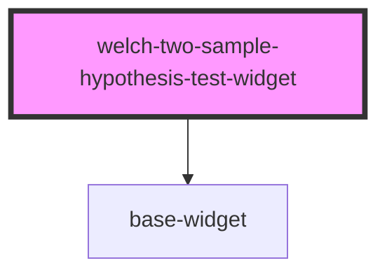

# text-widget

<!-- Auto Generated Below -->

## Properties

| Property         | Attribute      | Description | Type                                       | Default     |
| ---------------- | -------------- | ----------- | ------------------------------------------ | ----------- |
| `config`         | --             |             | `WelchTwoSampleHypothesisTestWidgetConfig` | `{}`        |
| `data`           | --             |             | `any[]`                                    | `[]`        |
| `fetchChartData` | --             |             | `Function`                                 | `undefined` |
| `height`         | `height`       |             | `number`                                   | `undefined` |
| `isInEditor`     | `is-in-editor` |             | `boolean`                                  | `false`     |
| `isViewer`       | `is-viewer`    |             | `boolean`                                  | `false`     |
| `readOnly`       | `read-only`    |             | `boolean`                                  | `false`     |
| `reportId`       | `report-id`    |             | `string`                                   | `undefined` |
| `widgetId`       | `widget-id`    |             | `string`                                   | `undefined` |
| `widgetTitle`    | `widget-title` |             | `string`                                   | `undefined` |
| `width`          | `width`        |             | `number`                                   | `undefined` |

## Dependencies

### Depends on

- [base-widget](.)

### Graph

----------------------------------------------

*Built with [StencilJS](https://stenciljs.com/)*
