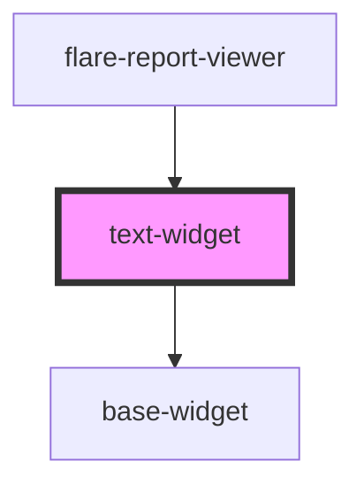

# text-widget

<!-- Auto Generated Below -->

## Properties

| Property      | Attribute      | Description | Type               | Default                                                                                                                                                                                                                                        |
| ------------- | -------------- | ----------- | ------------------ | ---------------------------------------------------------------------------------------------------------------------------------------------------------------------------------------------------------------------------------------------- |
| `config`      | `config`       |             | `TextWidgetConfig` | `{      text: 'Text content goes here',      fontSize: 'medium',      textAlign: 'left',     verticalAlign: 'top',     enableFormatting: false,     titleText: '',     titleSize: 'h2',     showDivider: false,     dividerStyle: 'solid'   }` |
| `height`      | `height`       |             | `number`           | `undefined`                                                                                                                                                                                                                                    |
| `isInEditor`  | `is-in-editor` |             | `boolean`          | `false`                                                                                                                                                                                                                                        |
| `readOnly`    | `read-only`    |             | `boolean`          | `false`                                                                                                                                                                                                                                        |
| `widgetId`    | `widget-id`    |             | `string`           | `undefined`                                                                                                                                                                                                                                    |
| `widgetTitle` | `widget-title` |             | `string`           | `undefined`                                                                                                                                                                                                                                    |
| `width`       | `width`        |             | `number`           | `undefined`                                                                                                                                                                                                                                    |

## Dependencies

### Used by

 - [flare-report-viewer](../flare-report-viewer)

### Depends on

- [base-widget](.)

### Graph

----------------------------------------------

*Built with [StencilJS](https://stenciljs.com/)*
