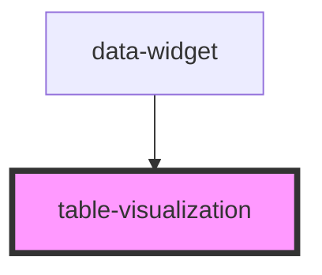

# table-visualization

<!-- Auto Generated Below -->

## Properties

| Property | Attribute | Description | Type                                                                                                                                                                                                                                                                                                                                                                                                             | Default     |
| -------- | --------- | ----------- | ---------------------------------------------------------------------------------------------------------------------------------------------------------------------------------------------------------------------------------------------------------------------------------------------------------------------------------------------------------------------------------------------------------------- | ----------- |
| `config` | `config`  |             | `BarChartConfig \| BoxWhiskerChartConfig \| BubbleChartConfig \| ClusteredBarChartConfig \| ClusteredHBarChartConfig \| DonutChartConfig \| HBarChartConfig \| HeatmapConfig \| HistogramConfig \| KpiConfig \| LineChartConfig \| LollipopChartConfig \| LollipopHChartConfig \| PieChartConfig \| ScatterChartConfig \| StackedBarChartConfig \| StackedHBarChartConfig \| SunburstChartConfig \| TableConfig` | `undefined` |
| `data`   | `data`    |             | `VisualizationData`                                                                                                                                                                                                                                                                                                                                                                                              | `undefined` |

## Events

| Event          | Description | Type                                   |
| -------------- | ----------- | -------------------------------------- |
| `filterChange` |             | `CustomEvent<FilterChangeEventDetail>` |

## Dependencies

### Used by

 - [data-widget](..)

### Graph

----------------------------------------------

*Built with [StencilJS](https://stenciljs.com/)*
